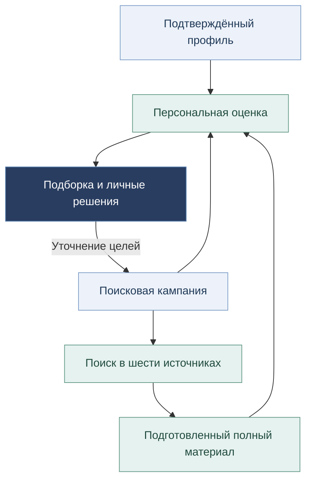
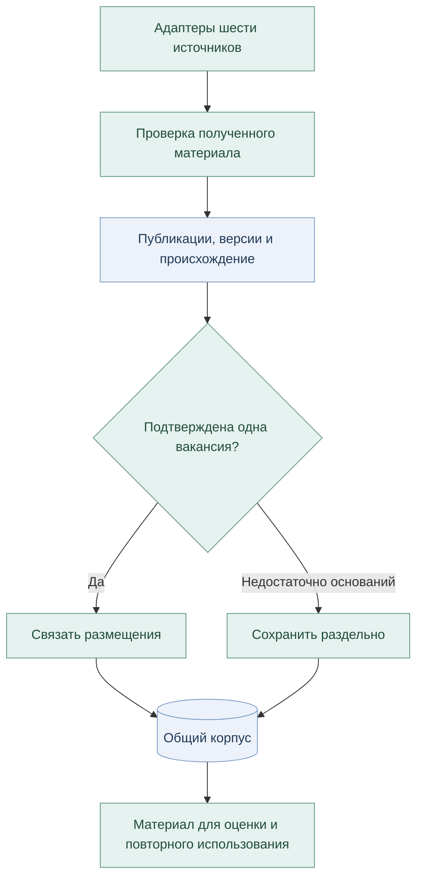
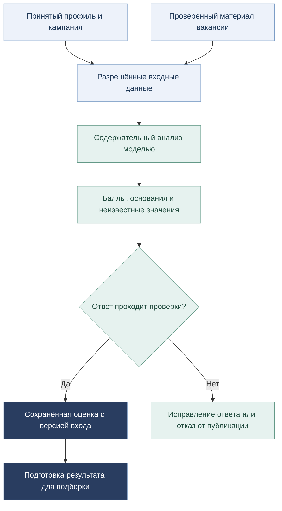
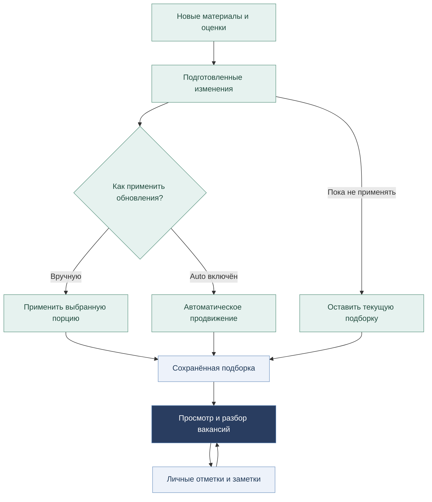
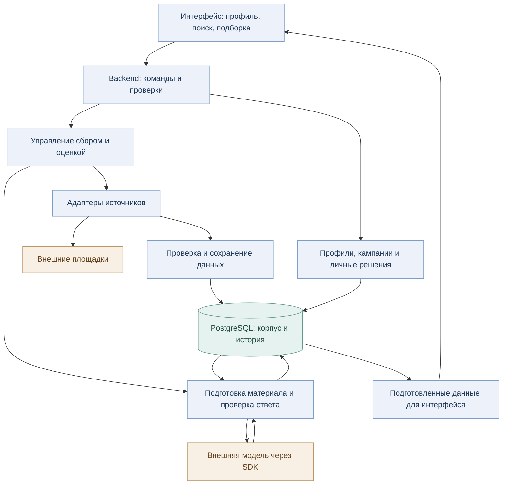

# Vacancy Collector: продукт и инженерные решения

**Персональный поиск работы, в котором собранные объявления становятся понятной подборкой для конкретного человека.**

[Обзор продукта](README.md) · [Реальные экраны](DEMO.md) · [Путь пользователя](#journey) · [Источники](#sources) · [AI-оценка](#evaluation) · [Архитектура](#architecture) · [Ключевые решения](#engineering) · [Мой вклад](#development) · [Развитие сервиса](#service)

Vacancy Collector вырос из моей собственной задачи поиска работы. Я хотел соединить широкий поиск, понимание профессионального опыта и удобное принятие решений в одном приложении. Сейчас это работающий локальный продукт: с реальными источниками, накопленным корпусом, AI-оценками, пользовательским интерфейсом, launcher и мониторингом исполнения.

Главный результат для пользователя — **подборка, которую можно разбирать осмысленно**: увидеть требования, сравнить их со своим опытом, понять основания оценки и сохранить решение. Для меня как инженера проект стал полным циклом работы: постановка задачи, архитектура, реализация с AI-инструментами, эксплуатация, обнаружение ограничений и переработка по результатам измерений.

Эта страница раскрывает, какие решения стоят за продуктом и зачем они нужны. Рабочие экраны и их пояснения собраны в [демонстрации](DEMO.md); актуальный состав возможностей — в [обзоре](README.md#status).

---

## 1. От профессионального опыта к подходящим возможностям

Представим разработчика, который ищет работу на пересечении Backend, AI и автоматизации. Подходящие задачи могут встречаться под названиями AI Engineer, LLM Developer, Backend Engineer или Integration Engineer. У каждого объявления свои акценты: где-то важны интеграции, где-то инфраструктура, а где-то нужен совсем другой профессиональный опыт.

Vacancy Collector связывает **то, что человек умеет**, **то, что он ищет**, и **то, что на самом деле описано в вакансии**.

**Профиль.** Пользователь добавляет резюме, документы и пояснения. AI помогает подготовить редактируемый профиль: описание, компетенции, опыт, проекты и дополнительные сведения. Можно сравнивать версии и исправлять формулировки. Рабочим основанием становится подтверждённая пользователем версия.

**Кампания.** Отдельно задаются направления поиска, зарплатные пожелания, география, формат работы и источники. AI помогает уточнить запрос; итоговый план принимает человек. Сейчас предпочтения используются как ориентиры широкого поиска и последующей оценки. Они не означают, что любое несовпадение автоматически исключит вакансию.

**Подборка.** Пользователь открывает подробности, сравнивает оценки, фильтрует результаты, добавляет избранное и заметки, скрывает или исключает вакансии. Отметка об отклике сохраняет личный статус; отправка работодателю остаётся отдельным действием пользователя.

Разделение профиля и кампании позволяет исследовать несколько профессиональных направлений с одним набором сведений об опыте. Уточнение цели поиска не требует каждый раз заново собирать резюме.

[Профиль, кампания и рабочая подборка на экранах →](DEMO.md)

## 2. Шесть источников — один корпус с сохранённой историей

В приложение интегрированы **HH, «Работа России», Хабр Карьера, GeekJob, GetMatch и Finder**. Для каждого источника реализован собственный адаптер с учётом его выдачи, форматов, ограничений и способов продолжения работы. Фактический охват зависит от доступности и возможностей площадки.

Общий корпус сохраняет происхождение данных, публикации и версии. Это позволяет связывать повторные размещения, возвращаться к исходным сведениям и повторно использовать пригодный материал в других кампаниях.

### Почему история важна пользователю

Одна позиция может появиться на нескольких площадках. При этом похожие заголовки ещё не доказывают, что предложения одинаковы. Система использует консервативное объединение: проверяет происхождение и существенные условия, сохраняет исходные размещения и не переносит оценку на другую работу только из-за сходства текста.

Например, вакансия сначала найдена на HH, а позднее — через Finder. Если происхождение и совместимость подтверждены, в подборке может появиться дополнительный источник без обязательного нового вызова модели. При существенных отличиях материал требует отдельной проверки.

### Почему обнаружение и оценивание разделены

Краткой карточки из выдачи может не хватать для содержательного анализа. Получение подробностей, подготовка полного материала и модельная оценка имеют отдельные состояния. Пользователь может различать найденный материал, готовность к анализу и уже полученные результаты.

Так корпус остаётся полезным накопленным активом: следующие запуски и кампании могут опираться на пригодные сохранённые данные. Обновления источников при этом продолжают проходить проверки актуальности и происхождения.

## 3. AI-оценка, которую можно разобрать

Оценивание сопоставляет конкретную вакансию с принятым профилем и условиями кампании. Пользователь получает общий балл, оценки отдельных сторон предложения, уверенность и объяснения.

Среди смысловых направлений — соответствие роли и опыта, реалистичность первичного отбора, возможности развития, качество предложения и оплата. **Общий балл — самостоятельное суждение модели, а не среднее всех показателей и не вероятность трудоустройства.** Когда сведений недостаточно, неизвестное значение сохраняется явно.

Backend проверяет структуру ответа, допустимость исходных оснований, привязку к вакансии и версии профессионального контекста. Такие проверки помогают не принять технически несогласованный ответ. Смысловую точность рекомендации пользователь всё равно оценивает по аргументам и исходному тексту.

**Проверяемость здесь означает возможность проследить происхождение вывода.** Можно понять, по каким сведениям оценивалась работа, какие стороны совпали с профилем и где информации недостаточно.

Оценка сохраняет связь со своими входными данными. Значимое изменение текста вакансии или принятого профиля требует пересмотра применимости прежнего результата; история при этом не переписывается. Подтверждённое эквивалентное размещение может сохранить применимость оценки и избежать лишней модельной обработки.

## 4. Подборка, которой управляет пользователь

Во время разбора вакансий сбор и оценивание могут продолжать приносить новые результаты. Чтобы пользователь мог последовательно изучать выбранные предложения, приложение различает **подготовленные обновления** и **уже применённую подборку**.

При выключенном Auto обычные новые результаты ждут применения. Пользователь решает, когда обновить рабочую подборку. Личные заметки и статусы сохраняются независимо от этого действия. Обязательные ограничения доступа, изменения принадлежности публикаций и явное исключение вакансии продолжают учитываться.

Ручное применение работает с заранее подготовленной порцией. Это позволяет вынести тяжёлую подготовку из самого действия пользователя. Автоматический режим также реализован; его сложные сочетания с историей и параллельными изменениями остаются частью дальнейшей стабилизации.

### Помощь при подготовке отклика

В продукте реализованы панели исследований компаний и сопроводительных писем, сохранённая история и ручное редактирование текста. Эти материалы расширяют путь от найденной вакансии к подготовленному отклику.

Интеграция новой AI-генерации с текущей рабочей подборкой ещё требует доводки. Поэтому весь сценарий исследования и генерации письма пока не представлен как полностью готовая пользовательская возможность.

## 5. Архитектура с разделённой ответственностью

Текущая система — **локальное Windows-приложение с React/TypeScript, Backend на Python/FastAPI и PostgreSQL**. Основные возможности собраны в одном модульном приложении. Интерфейс, операции с данными, интеграции источников и модельная обработка имеют отдельные обязанности.

Схема показывает ответственность частей системы и основные направления работы с данными. Внешние площадки и модель выделены отдельно: локальная установка приложения не означает, что все операции выполняются без сетевых обращений.

**Backend владеет принятыми решениями.** Браузер отображает данные и отправляет команды. Принятие профиля, сохранение оценки, применение обновлений и проверка разрешений выполняются на серверной стороне приложения.

**Длительные операции сохраняют своё состояние.** Сбор, подготовка и модельная работа имеют управляемые задания, историю попыток и подтверждения результата. Это даёт основу для восстановления и позволяет различать остановленную работу, известный ответ и неизвестный исход внешнего вызова.

**PostgreSQL хранит рабочие данные.** Текущая версия перешла на PostgreSQL; прежняя SQLite относится к истории разработки. Короткие транзакции и отдельная подготовка результатов поддерживают конкурентную обработку. Обращения к источникам и модели выполняются вне длительной транзакции БД.

**Интерфейс читает подготовленные данные.** Серверные фильтры, ограниченные выборки, виртуализация таблицы и отдельная загрузка подробностей помогают работать с накопленным корпусом. Launcher и журналы мониторинга делают запуск и состояние обработки наблюдаемыми.

[Launcher, мониторинг и рабочий интерфейс →](DEMO.md)

## 6. Решения, которые проявились в реальной работе

На опубликованном срезе мониторинга от **19.11.2026** видны **41 070 карточек источников, 8 254 полных текста и 1 098 сохранённых результатов оценки**. Это наблюдение конкретной рабочей установки. История оценивания включает замены и результаты профессионального несоответствия, поэтому её количество не равно размеру применённой подборки. [Скриншот и расшифровка показателей →](DEMO.md#monitoring)

| Ситуация | Инженерное решение | Польза для продукта |
|---|---|---|
| Похожая вакансия появляется на другой площадке | Проверка происхождения, идентичности и существенных условий; сохранение отдельных размещений | Более цельная подборка без необоснованного объединения разных позиций |
| У уже оценённой вакансии появляется эквивалентный источник | Проверка применимости сохранённой оценки | Возможность повторного использования результата без обязательного нового вызова модели |
| Ответ внешней операции потерялся | Сохранение точного намерения и попытки; выяснение исхода перед повтором | Контроль дублирования работы и расхода ресурсов |
| Новые результаты поступают во время просмотра | Подготовленные обновления отделены от применённой подборки | Пользователь сам выбирает момент обычного обновления таблицы |
| Рост корпуса замедляет чтение и применение результатов | Подготовленные представления, ограниченные чтения, короткие транзакции, виртуализация | Оптимизация всего пути от данных до действия в интерфейсе |
| Нужно понять, что делает длительный запуск | Раздельный прогресс сбора, подготовки и оценки, launcher и мониторинг | Наблюдаемость работы и возможность локализовать задержку |

Эти решения появились из конкретных сценариев использования. Например, медленное применение результатов потребовало пересмотреть, какая работа должна выполняться заранее, а какая — непосредственно при подтверждении пользователем. Так подготовка данных стала отдельной частью архитектуры.

В проекте используются проверки адаптеров, работы с БД и API, повторных команд и асинхронных состояний, контроллеров интерфейса, типов и архитектурных границ. Дальнейшая стабилизация опирается на реальные сценарии и адресные проверки. Наличие тестового набора само по себе не означает подтверждённую готовность публичного сервиса.

## 7. Мой вклад: от задачи до работающего продукта

Я самостоятельно определил продуктовую задачу, пользовательский сценарий и требования к результату. Спроектировал разделение данных, интеграций, AI-операций и интерфейса; организовал реализацию с помощью ChatGPT/Codex и проверял получаемые решения.

| Участок работы | За что я отвечал |
|---|---|
| **Продукт** | Потребность, сценарии, приоритеты, состав возможностей и критерии полезности |
| **Архитектура** | Границы компонентов, модель данных, правила принятия решений и сохранения результатов |
| **Реализация с AI** | Постановка задач, управление объёмом изменений, проверка кода и согласование частей системы |
| **Пользовательский опыт** | Логика экранов, управление поиском, разбор подборки и ручная приёмка |
| **Эксплуатация** | Работа на реальных данных, анализ задержек, выбор направлений исправления и повторная проверка |

По мере развития я расширил исходную задачу: заложил основу для будущего сервиса с несколькими пользователями. Это повлияло на модель владения данными, разделение общего корпуса и персональных результатов, проверку прав и устройство длительных операций.

На демонстрации могу пройти рабочий сценарий, показать интерфейс и мониторинг, объяснить причины архитектурных решений и разобрать изменения после реального использования.

[Как организована разработка с AI — Command Center →](https://github.com/Vkuvalin/command-center-public)

## 8. Следующий продуктовый слой: аналитика накопленных данных

Корпус уже содержит материал для дальнейшего анализа. Следующий шаг — превратить его в отдельный пользовательский раздел: определить метрики, обеспечить корректные выборки и представить результаты так, чтобы они помогали принимать решения.

| Направление | На какой вопрос отвечает |
|---|---|
| **Навыки и роли** | Какие компетенции встречаются в выбранном направлении и как они сочетаются |
| **Компании и предложения** | Какие работодатели представлены в корпусе и какие задачи они предлагают |
| **Условия и компенсация** | Как различаются наблюдаемые предложения по ролям, форматам работы и оплате |
| **Профиль и рынок** | Какие требования совпадают с опытом человека и где заметны пробелы |
| **AI-исследования** | Что можно выяснить по конкретному вопросу к накопленной выборке |

**Отдельный аналитический экран ещё не реализован как рабочая возможность.** Его изображения в демонстрации — визуальная концепция. Данные отдельной кампании описывают собранную выборку; рыночные выводы требуют оценки её охвата, качества и репрезентативности.

[Визуальная концепция аналитики →](DEMO.md#analytics-concepts)

## 9. Задел для многопользовательского сервиса

Многопользовательское развитие было осознанным направлением архитектуры. В текущей реализации общий корпус отделён от профессиональных контекстов, кампаний, личных отметок и результатов. Операции проверяют принадлежность данных и допустимость действий; браузер не назначает себе владельца или разрешения.

Это полезная основа следующей версии: развивать сервис можно вокруг уже выделенных областей ответственности. **Сейчас приложение рассчитано на одного локального пользователя.** Наличие внутренних привязок к владельцу ещё не подтверждает готовность обслуживать независимых пользователей через интернет.

| Основа уже есть | Что потребуется для сервиса |
|---|---|
| Общий корпус и отдельные персональные контексты | Полноценные учётные записи и проверенная изоляция данных пользователей |
| Серверные проверки действий и разрешений | Система входа, управление сессиями и защита публичного доступа |
| Сохраняемые задания и конкурентная обработка | Управление общей нагрузкой, квотами и стоимостью операций |
| PostgreSQL, launcher и наблюдаемость локальной работы | Серверное размещение, обновления, резервирование и эксплуатационный мониторинг |
| Интеграции источников и модельная обработка | Проверка допустимых условий использования данных и экономики продукта |

**План развития:** после другого приоритетного проекта я намерен вернуться к Vacancy Collector, завершить аналитику и необходимые доработки, подготовить многопользовательскую эксплуатацию и вывести продукт на рынок. Срок запуска и коммерческая модель пока не определены.

Работающий локальный продукт уже позволяет показывать основной пользовательский путь и проверять инженерные решения на реальных данных. Следующая версия должна сохранить эту практическую ценность при переходе к другим условиям использования.

---

[Обзор продукта](README.md) · [Реальные экраны](DEMO.md) · [К началу](#top)
