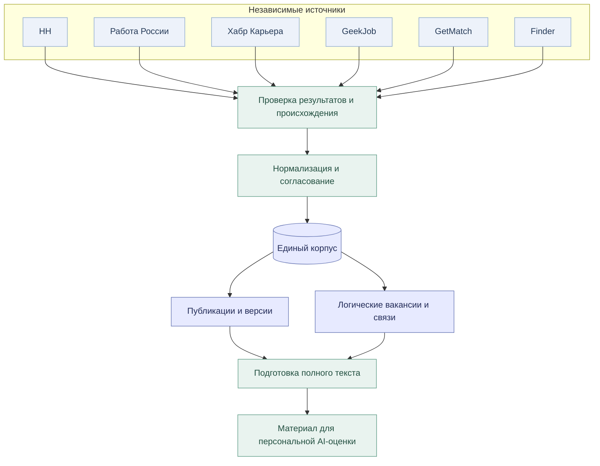
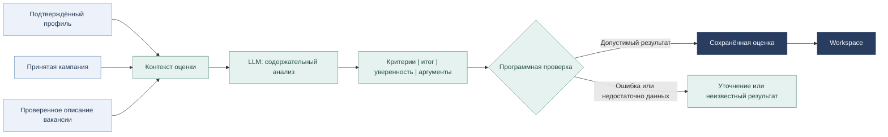
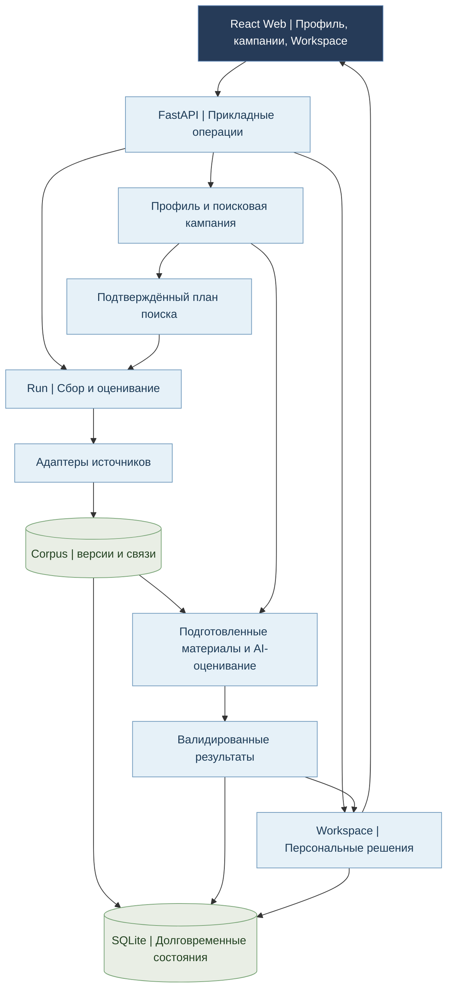

# Vacancy Collector | продукт и архитектура

**От профессионального контекста — к проверяемым вакансиям, персональной AI-оценке и управляемой рабочей подборке.**

[Обзор](README.md) | [Пользовательский путь](#journey) | [Данные и источники](#sources) | [AI-оценка](#evaluation) | [Архитектура](#architecture) | [Инженерные решения](#engineering) | [Путь создания](#development) | [Развитие](#analytics)

Vacancy Collector начинался как личный инструмент поиска работы. Его задача выросла от объединения объявлений до сквозного процесса: пользователь описывает свой профессиональный опыт и цель, приложение собирает и систематизирует данные, модель помогает оценить соответствие, а Workspace превращает результаты в последовательные пользовательские решения.

Ниже показаны **продуктовый сценарий и логическая архитектура**, а не внутренние API, приватные промпты или карта файлов. [Краткое знакомство и визуальные материалы →](README.md)

---

## 1. Путь пользователя

### Профессиональный контекст

Первый этап — не просто загрузка резюме. Пользователь собирает документы и пояснения, получает AI-assisted черновик профиля и может редактировать его по пяти смысловым областям: описание, компетенции, опыт, проекты и дополнительные сведения. Предыдущие версии доступны для сравнения; обновления не принимаются без решения пользователя.

Профиль описывает **имеющийся опыт**. Поисковая кампания описывает **желаемую работу**. Это разные сущности: один и тот же профессиональный контекст может использоваться для нескольких направлений поиска.

### Кампания и сбор

Пользователь задаёт направления, географию, условия и пожелания. AI помогает подготовить варианты формулировок и поискового лексикона, после чего человек подтверждает итоговый вариант. Приложение преобразует его в источник-специфичные поисковые действия. Отдельный запуск начинает сбор; просмотр или редактирование не запускают его автоматически.

### От анализа к действию

Вакансии появляются в едином рабочем пространстве по мере подготовки и оценки. Пользователь может фильтровать их, открыть подробное описание, изучить баллы и основания, отметить понравившееся предложение, записать заметку и вести статусы рассмотрения. Отметка «Откликнулся» фиксирует его действие; это не автоматическая отправка заявки работодателю.

**Главный принцип:** AI помогает разобраться в большом потоке объявлений, но факты профиля, цель поиска и решения об откликах остаются под контролем человека.

[Референсы профиля, кампании и Workspace →](README.md#interface)

## 2. Шесть источников и один проверяемый корпус

Поисковые площадки имеют разные интерфейсы получения данных, форматы выдачи, ограничения и способы продолжения незавершённого сбора. Поэтому приложение не пытается свести все интеграции к одному универсальному парсеру. У каждой площадки — собственный адаптер, а над ними работает общая граница проверки и приведения данных.

### Отдельная публикация ≠ отдельная вакансия

Объявление с идентификатором на одной площадке, новая версия этого объявления и вакансия как единое предложение работодателя — разные вещи. Одно предложение может появиться на двух площадках; два похожих описания могут относиться к разным позициям.

Corpus сохраняет историю наблюдений, источниковые публикации, версии материала и связи между ними. Автоматическое объединение намеренно **консервативно**: нужны убедительные сведения об общей идентичности и совместимости существенных условий. Если доказательств недостаточно, записи остаются раздельными.

Это защищает не только данные, но и последующую AI-оценку: нельзя незаметно перенести вывод модели с одной работы на другую.

### Полный текст и актуальность

Найденная краткая карточка ещё не равна подготовленной вакансии. Для содержательного анализа нужен достаточно полный, проверенный материал. Источник может дать его сразу или через отдельное получение подробностей. Состояния обнаружения, полноты, готовности, оценки и включения в подборку разделены.

**Практический результат:** общий корпус можно пополнять и переиспользовать между поисковыми кампаниями, сохраняя происхождение данных и историю изменений.

## 3. Персональная AI-оценка

Модель не оценивает «вакансию вообще». Она сопоставляет содержание предложения с двумя принятыми пользователем основаниями: **профессиональным профилем** и **целью конкретной кампании**.

### Почему оценка объяснима

Результат содержит девять критериев, раздельные общий балл и показатель уверенности, а также объяснения и ссылки на допустимые исходные свидетельства. Для критериев используется шкала **0–100** либо **неизвестное значение**, если оснований недостаточно. Балл не является вероятностью трудоустройства.

Backend проверяет структуру ответа, связь с исходными данными, допустимые цитаты, версию входа и соответствие конкретной операции. Модель не получает права сама объявлять свои выводы достоверными или менять пользовательский профиль.

Особый случай — фундаментальное профессиональное несоответствие. Оно требует отдельных обоснований. Низкий общий балл, другая география или предпочтение работы в офисе сами по себе не превращают предложение в безусловно неподходящее.

### Оценка привязана к версии данных

Если после анализа у вакансии изменилось существенное описание или пользователь подтвердил новый профиль, прежний результат сохраняется как история, но его применимость пересматривается. Если появилась вторая подтверждённо эквивалентная публикация без изменения значимых условий, новый вызов модели не обязателен.

**Это основной инженерный баланс:** широкое обнаружение, аккуратные данные и персональный смысловой анализ без произвольной переоценки каждого обновления.

## 4. Логическая архитектура

Vacancy Collector построен как локальное модульное приложение: React/TypeScript Web, FastAPI и Python backend с SQLite. Оно не требует распределённых микросервисов для своего текущего назначения. При этом обязанности разделены так, чтобы развивать обработку данных, AI-пайплайн и интерфейс независимо.

**Данные остаются у приложения.** Адаптер отвечает за получение материала своей площадки; центральный слой — за проверку и нормализацию; Corpus — за историю; AI-подсистема — за модельное предложение и его проверку; Workspace — за применённую подборку и личные действия.

**Долгие процессы имеют собственную жизнь.** Run сохраняет задания, состояния и результаты между действиями пользователя. Пауза, остановка, частичное завершение и потеря подтверждения не являются одним событием. Сетевая и модельная обработка вынесены за долгие блокирующие SQL-транзакции; сохранённые подтверждения и версии позволяют продолжать работу после сбоя.

**Web работает с ограниченными выборками.** Для большой подборки используются серверные фильтры, окна чтения, виртуализированная таблица и отдельная загрузка подробностей. По мере оптимизации сокращаются повторная подготовка данных и объём работы при каждом обновлении экрана.

## 5. Инженерные решения на конкретных ситуациях

| Ситуация | Решение | Почему это важно |
|---|---|---|
| Одна вакансия найдена на нескольких площадках | Проверка идентичности и существенных условий; отдельные версии и источники | Не теряются размещения и не объединяются разные предложения по одному похожему названию |
| Новый источник подтвердил уже оценённую вакансию | Проверка применимости предыдущей оценки | Можно переиспользовать результат без обязательного повторного LLM-вызова |
| Модель ответила, но подтверждение операции потерялось | Сохранение попытки, статуса и оригинального намерения; сверка исхода | Избежание слепого повторного расхода ресурсов и дублирования результатов |
| Во время чтения поступили новые AI-оценки | Разделение текущего состояния и применённой подборки; явный Apply или выбранный Auto | Рабочая таблица не перестраивается неожиданно под действиями пользователя |
| На большом корпусе медленно открывается карточка | Ограниченные SQL-чтения, подготовленные представления, кэш и виртуализация | Производительность решается вдоль всего пути данных, а не только сокращением DOM |

### Один пример: повторное размещение

Предположим, одна и та же позиция сначала была получена через HH, а затем появилась в Finder. Проверка происхождения и содержательной эквивалентности определяет, можно ли связать обе публикации. При подтверждённой совместимости исходная оценка остаётся привязанной к своему материалу, а пользователь получает дополнительный источник. При важных отличиях сведения не сливаются без доказательств.

Это небольшой сценарий, но он одновременно затрагивает **идентичность данных, версионирование, доверие к источнику, стоимость AI-обработки и корректность пользовательской подборки**.

### Проверка и развитие после реального использования

В проекте применяются source-native/offline fixtures, SQL и API-тесты, тесты асинхронных состояний и повторных операций, проверки React-контроллеров, статический анализ и архитектурное review. После первого реального цикла отдельной работой стали измерения задержек, устранение лишних чтений, уменьшение времени удержания транзакций и восстановление поведения Workspace на большом корпусе.

**Практический принцип:** пользовательское наблюдение → локализация причины → ограниченное изменение → проверка → повторная приёмка. Так развивались надёжность и производительность продукта после его первого рабочего применения.

## 6. От идеи до личного рабочего продукта

| Фаза | Что было создано |
|---|---|
| **Идея и постановка задачи** | Цель заменить ручной просмотр множества площадок персональным инструментом для поиска подходящей работы |
| **Сбор из разных источников** | Шесть source-native адаптеров, проверка результатов, возможность возобновления и центральная нормализация |
| **Единый корпус** | Постоянные публикации, версии, история наблюдений и аккуратное связывание одинаковых вакансий |
| **Профессиональная модель** | Исходные материалы, редактируемый AI-профиль, независимая кампания и подтверждённый план поиска |
| **AI-оценка и исполнение** | Специализированный анализ, проверяемые результаты, Run, попытки и обработка долгих операций |
| **Web-продукт** | Светлая пользовательская цепочка, Workspace, личные решения, обратная связь и приёмка интерфейса |
| **Реальная эксплуатация** | Сбор тысяч источниковых публикаций, сотни AI-оценок, проверка полезности рекомендаций и обнаружение узких мест |
| **Оптимизация** | Рефакторинг очередей, подготовленных данных, конкурентного исполнения, чтения Workspace и восстановления |

### Моя роль

Это самостоятельно инициированный и управляемый проект с AI-assisted реализацией. Я формулировал продуктовую задачу и требования, прорабатывал архитектуру и пользовательский опыт, организовывал реализацию с помощью ChatGPT/Codex, критически проверял изменения и проводил эксплуатационные и визуальные испытания. После обнаружения проблем на реальной базе выбирал направления исправления и оценивал результат.

Задача была не в том, чтобы создать как можно больше модулей. **Цель — получить работающий инструмент, который помогает мне искать работу и остаётся понятным в дальнейшем развитии.**

## 7. Возможное развитие: персональная и рыночная аналитика

Версионированный корпус уже создаёт основу для следующего исследовательского слоя. Возможные направления:

- **Картина рынка:** динамика спроса, диапазоны компенсации, распределение ролей, технологий и форматов работы на основе собранных объявлений.
- **Компании и технологии:** какие работодатели появляются в выборке, какие команды и компетенции они ищут, как меняются наблюдаемые приоритеты.
- **Мой профиль и рынок:** сопоставление профессионального контекста и реальных требований, возможные направления развития и обнаруженные пробелы.
- **AI-исследования:** целевые вопросы к накопленному корпусу, связанные с выбранным направлением и конкретными условиями поиска.

Эти возможности показаны в визуальных концептах, но **аналитический экран ещё не реализован**. Их ценность зависит от полноты и репрезентативности исходной выборки: данные отдельной поисковой кампании нельзя автоматически выдавать за весь рынок труда.

<!-- IMAGE_SLOT_ANALYTICS_REFERENCE: contact_market_analytics_v02_accepted.jpg | Вставляется пользователем в README.md#analytics; здесь сохранена ссылка на его раздел, чтобы не повторять большое изображение. -->

[Коллаж визуальной концепции →](README.md#analytics)

Отдельная перспектива — развитие личного инструмента в многопользовательский сервис. Её рассмотрение требует подтверждения спроса, требований к совместному корпусу, приватности, внешним источникам и экономике эксплуатации. Это **возможность архитектурного развития**, а не уже запущенный SaaS.

---

**[Вернуться к README →](README.md)** | [Показать визуальные материалы →](README.md#interface)
