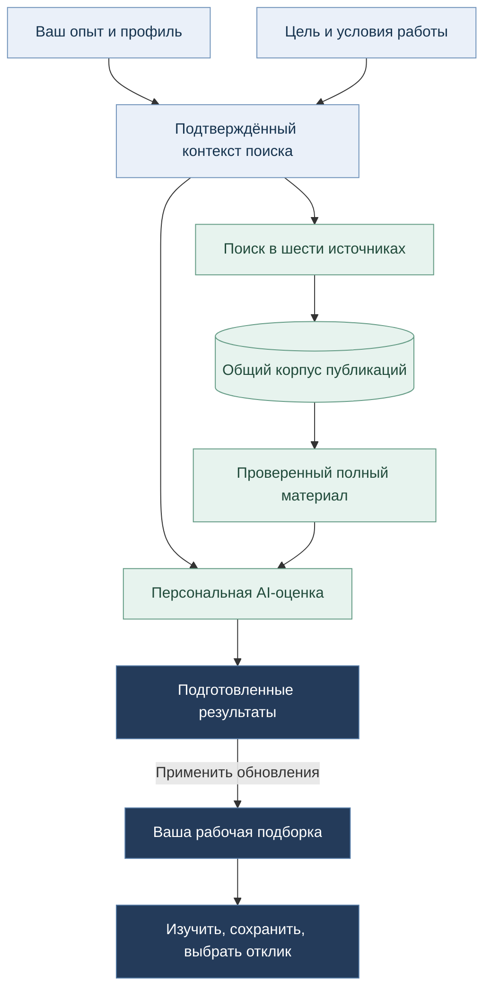

# Vacancy Collector

## Вакансии из шести источников. Приоритеты — по вашему опыту.

**Персональный AI-инструмент поиска работы: от резюме и карьерной цели до объяснимой подборки и решений об откликах.**

[Продукт](#product) · [Реальные экраны](#interface) · [Как работает](#workflow) · [Инженерные решения](PRESENTATION.md#engineering) · [Развитие сервиса](#analytics) · [Мой вклад](#ownership)

**Работающее локальное Windows-приложение**, которое я использую для собственного поиска работы. Оно объединяет профессиональный профиль, поиск на нескольких площадках, проверку и хранение объявлений, персональную AI-оценку и рабочую подборку в браузере.

Архитектура создавалась с расчётом на дальнейший многопользовательский продукт. Сегодня это личный рабочий инструмент; следующий продуктовый горизонт — аналитика накопленных данных и коммерческий сервис.

*Реальный экран запущенного приложения. Таблица, оценка и исходное описание вакансии доступны в одном рабочем пространстве. [Посмотреть весь сценарий →](DEMO.md)*

### Уже работает с накопленными данными

| Карточки источников | Публикации с полным материалом | Сохранённые результаты оценки |
|---:|---:|---:|
| **41 070** | **8 254** | **1 098** |

Данные одного рабочего среза **19 ноября 2026, 11:33 MSK**, показанного на [экране мониторинга](DEMO.md#monitoring). Результаты оценки включают историю замен; это не число подходящих вакансий или размер применённой подборки.

---

## От множества объявлений — к осмысленному выбору

Подходящая работа может называться по-разному на разных площадках. Объявления повторяются, требования приходится сопоставлять со своим опытом, а интересные позиции легко теряются среди вкладок и заметок.

**Vacancy Collector собирает этот процесс в одном месте.** Пользователь задаёт профессиональный контекст и направление поиска. Приложение получает объявления, подготавливает материал и помогает понять, какие предложения стоит изучить первыми — и почему.

| Задача | Что даёт продукт |
|---|---|
| Найти подходящие позиции за пределами одного названия должности | Кампания с направлениями поиска и адаптацией запросов под разные площадки |
| Сравнить требования со своим опытом | AI-оценка относительно подтверждённого профиля: критерии, общий балл, уверенность и аргументы |
| Разобраться с повторными объявлениями | Единый корпус, сохранённые источники и аккуратное связывание публикаций одной вакансии |
| Спокойно изучить результаты | Подробная карточка рядом с таблицей; сортировка, фильтры и управляемое применение обновлений |
| Сохранить собственные решения | Избранное, заметки, статусы рассмотрения и отметки об откликах |
| Продолжить поиск с другой целью | Отдельные профессиональные контексты и кампании с повторным использованием пригодного материала |

### Например: искать работу по содержанию, а не только по названию

Разработчик ищет задачи на пересечении Backend, LLM и автоматизации. Нужная позиция может называться *AI Engineer*, *LLM Developer*, *Backend Engineer* или *Integration Engineer*.

Кампания позволяет описать это направление шире одного поискового запроса. Затем AI сопоставляет содержание каждой подготовленной вакансии с опытом человека. В результате пользователь видит основания оценки и возможные пробелы, а не только совпадение ключевых слов.

Баллы помогают расставить приоритеты. Окончательное решение остаётся за человеком: можно прочитать исходный материал, проверить аргументы и выбрать дальнейшее действие.

## Продукт в работе

В демонстрации — **пять реальных экранов программы**: профессиональный профиль, поисковая кампания, подборка вакансий, Windows launcher и мониторинг. Они показывают пользовательский сценарий и то, как приложение запускается и наблюдается в работе.

| Что посмотреть | Зачем это пользователю |
|---|---|
| [Профессиональный профиль](DEMO.md#profile) | Зафиксировать опыт, на который будет опираться оценка |
| [Поисковая кампания](DEMO.md#campaign) | Задать цель, условия и направления поиска |
| [Рабочая подборка](DEMO.md#workspace) | Сравнивать вакансии, читать объяснения и сохранять решения |
| [Windows launcher](DEMO.md#launcher) | Запускать приложение и проверять состояние его компонентов |
| [Мониторинг](DEMO.md#monitoring) | Видеть, что собрано, подготовлено и оценено, и наблюдать ход обработки |

**[Открыть демонстрацию с пояснениями к каждому экрану →](DEMO.md)**

## Как получается персональная подборка

Профиль и кампания подтверждаются пользователем. Сбор запускается отдельно; новые результаты сначала подготавливаются, а затем применяются к рабочей подборке. Личные заметки и статусы сохраняются независимо от обновления оценок.

**AI отвечает за содержательный анализ, приложение — за данные и выполнение операций, человек — за намерения и решения.** Отметка об отклике фиксирует действие пользователя; автоматической отправки работодателю в текущем продукте нет.

[Подробный пользовательский путь →](PRESENTATION.md#journey) · [Как устроена оценка →](PRESENTATION.md#evaluation)

## Что стоит за интерфейсом

**Шесть самостоятельных интеграций.** HH, «Работа России», Хабр Карьера, GeekJob, GetMatch и Finder подключены через специализированные адаптеры. Они учитывают различия площадок; общий слой проверяет результат и сохраняет происхождение данных.

**Накопление вместо одноразовой выдачи.** PostgreSQL хранит публикации, версии, связи, оценки и пользовательские решения. Пригодный материал можно использовать в следующих запусках, а подтверждённо эквивалентное размещение не обязательно требует нового вызова модели.

**AI внутри управляемого процесса.** Оценка связана с конкретными версиями профиля, кампании и вакансии. Ответ проходит программную проверку. Состояния заданий, подтверждения и история попыток помогают разбирать частичные и неоднозначные исходы длительных операций.

**Доработка на реальной нагрузке.** После практического использования система получила центральную PostgreSQL, параллельную обработку, подготовку результатов в фоне, более короткие транзакции и ограниченные чтения для интерфейса. Launcher и мониторинг стали частью ежедневной работы с продуктом.

[Разбор ситуаций, решений и компромиссов →](PRESENTATION.md#engineering) · [Логическая архитектура →](PRESENTATION.md#architecture)

## От личного инструмента — к сервису

Многопользовательская перспектива учитывалась при проектировании: общий корпус отделён от персональных контекстов и кампаний, личные решения имеют владельца, а интерфейс обращается к Backend через отдельный API. Это даёт основу для развития продукта без привязки всей логики к одному экрану или одной поисковой сессии.

Следующие направления:

| Направление | Что предстоит получить |
|---|---|
| **Аналитика накопленного корпуса** | Исследование навыков, ролей, компаний и зарплат в собранной выборке; сопоставление рынка с профилем |
| **Помощь с откликом** | Завершённый сквозной сценарий исследований компаний и подготовки писем на существующем фундаменте |
| **Многопользовательский сервис** | Аккаунты, серверная авторизация и проверенная изоляция данных; управление общей нагрузкой и эксплуатацией |
| **Коммерческий продукт** | Доступ для внешних пользователей, модель оплаты и проверка экономики работы с источниками и AI |

**Отдельный аналитический экран ещё предстоит реализовать.** Накопленные данные и их история уже дают основу для этой работы; визуальные концепции показаны [отдельно от рабочих экранов](DEMO.md#analytics-concepts).

Мой план — вернуться к развитию Vacancy Collector после другого приоритетного проекта, завершить аналитику и подготовить коммерческий сервис. Серверный запуск и многопользовательская эксплуатация потребуют отдельного этапа разработки и проверки.

[Как существующая архитектура поддерживает этот путь →](PRESENTATION.md#service)

## Технологии

| Часть продукта | Основа |
|---|---|
| Backend и данные | Python, FastAPI, PostgreSQL, SQLAlchemy Core, psycopg, Alembic |
| Интерфейс | React, TypeScript, Vite, виртуализация таблицы |
| AI | Codex SDK, специализированные задачи, типизированные результаты и проверки |
| Исполнение и эксплуатация | Сохранённые задания и попытки, подготовленные очереди, Windows launcher, журналы и мониторинг |
| Качество разработки | pytest, Vitest, Ruff, Pyright, архитектурные проверки и практическая проверка сценариев |

## Мой вклад

**Я создал и развиваю Vacancy Collector как самостоятельный продукт полного цикла с использованием ChatGPT/Codex.** Отправной точкой была личная задача поиска работы; затем я расширил замысел до основы будущего сервиса.

Моя работа охватывает постановку задачи и требования, пользовательские сценарии, модель данных и границы ответственности, организацию реализации с AI-инструментами, проверку изменений и развитие продукта после реального использования. Отдельной частью стали диагностика узких мест, пересмотр ранних решений и переход к более подходящей архитектуре хранения и исполнения.

Этот проект показывает, как я связываю **продуктовую задачу, LLM, обработку данных, Backend, интерфейс и эксплуатацию** в одну работающую систему.

[История разработки и ключевые решения →](PRESENTATION.md#development) · [Command Center — организация разработки с AI](https://github.com/Vkuvalin/command-center-public)

## Текущий статус

**Рабочее локальное приложение для личного использования.** Основной путь — профиль, кампания, сбор, оценка и разбор вакансий — реализован и используется на реальных данных. Отдельные сценарии и производительность требуют дальнейшей стабилизации. Исследования компаний и письма имеют реализацию и сохранённую историю; их сквозная интеграция требует доводки.

Публичный сервис, оплата и отдельная рыночная аналитика относятся к дальнейшему развитию. Текущее приложение рассчитано на одного локального пользователя. Подробное различение возможностей — [в демонстрации](DEMO.md#status) и [плане развития](PRESENTATION.md#analytics).

---

**Обсудить продукт или посмотреть демонстрацию:** [Владислав Кувалин](https://github.com/Vkuvalin).

На собеседовании могу показать рабочий сценарий и объяснить принятые продуктовые и инженерные решения. Этот репозиторий содержит публичную презентацию; исходный код и внутренняя документация проекта остаются приватными.

[Демонстрация →](DEMO.md) · [Продукт и архитектура →](PRESENTATION.md) · [К началу ↑](#top)
